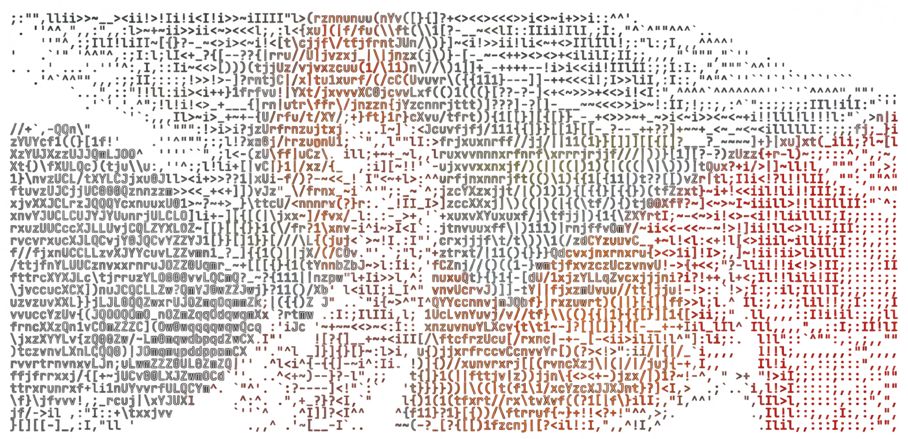

<!--
Source - https://stackoverflow.com/a/70200610
Posted by Giorgos Xou, modified by community. See post 'Timeline' for change history
Retrieved 2026-11-18, License - CC BY-SA 4.0
-->

<picture>
  <source media="(prefers-color-scheme: dark)" srcset="https://github.com/jlalbers/jlalbers/blob/611bdcfa931d09e027657b28f799b57bbe8d6152/handshake-ascii-transparent.png">
  <source media="(prefers-color-scheme: light)" srcset="https://github.com/jlalbers/jlalbers/blob/611bdcfa931d09e027657b28f799b57bbe8d6152/ascii-art-2026-11-19-02-20-53.png">
  
</picture>

<!---

- 👋 Hi, I’m @jlalbers (a.k.a. Jameson)
- 👀 I’m interested in ...
  - Quantum Computing
  - Practical AI
  - Optimization
  - Learning new languages!
- 🌱 I’m currently learning ...
  - Nonlinear Programming
  - Functional Programming
  - Quantum Programming
  - Distributed Systems
- 💞️ I’m looking to collaborate on ...
  - Solving your optimization problems
- 📫 How to reach me ...
  - LinkedIn: https://www.linkedin.com/in/j-albers
--->
<!---
jlalbers/jlalbers is a ✨ special ✨ repository because its `README.md` (this file) appears on your GitHub profile.
You can click the Preview link to take a look at your changes.
--->
