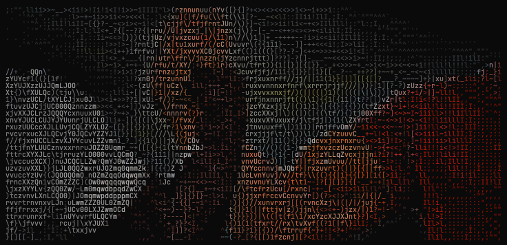

<!---
- 👋 Hi, I’m @jlalbers (a.k.a. Jameson)
- 👀 I’m interested in ...
  - Quantum Computing
  - Practical AI
  - Optimization
  - Learning new languages!
- 🌱 I’m currently learning ...
  - Nonlinear Programming
  - Functional Programming
  - Quantum Programming
  - Distributed Systems
- 💞️ I’m looking to collaborate on ...
  - Solving your optimization problems
- 📫 How to reach me ...
  - LinkedIn: https://www.linkedin.com/in/j-albers
--->
<!---
jlalbers/jlalbers is a ✨ special ✨ repository because its `README.md` (this file) appears on your GitHub profile.
You can click the Preview link to take a look at your changes.
--->
